<div align="center">

<!-- ========================================== -->
<!-- 1. LIVE ANIMATED CONTRIBUTION HEATMAP -->
<!-- Auto-refreshed daily by GitHub Actions -->
<!-- ========================================== -->

<h3><code>sandeep@data-platform ~ $ ./contributions.sh</code></h3>



<br><br>

<!-- ========================================== -->
<!-- 2. ANIMATED ASCII PORTRAIT + NEOFETCH INFO -->
<!-- ========================================== -->

<h3><code>sandeep@data-platform ~ $ whoami --expertise</code></h3>

<table>
  <tr>
    <td valign="top">
      
    </td>
    <td valign="top">
      
    </td>
  </tr>
</table>

<br><br>

<!-- ========================================== -->
<!-- 3. FEATURED DATA ENGINEERING & AI PROJECTS -->
<!-- ========================================== -->

<h3><code>sandeep@data-platform ~ $ ls -la ./featured-projects/</code></h3>

</div>

```
drwxr-xr-x  sandeep  data  [Project 01]  Apex F1: Data Platform & AI Knowledge Assistant
drwxr-xr-x  sandeep  data  [Project 02]  Sterling Financial Analytics (Microsoft Fabric + Azure AI)
drwxr-xr-x  sandeep  data  [Project 03]  Deep-Agent Data Lab (Autonomous Agentic Analytics)
```

<table>
  <tr>
    <td width="50%" valign="top">
      <h3>🏎️ 01. Apex F1: Data Platform & AI</h3>
      <p>
        Formula 1 analytical data engineering platform with <b>Medallion architecture</b> (Bronze, Silver, Gold star schema) on <b>Databricks Lakehouse</b> & <b>Delta Lake</b>, <b>Apache Airflow</b> orchestration, <b>DuckDB</b> OLAP queries, and a Streamlit-powered RAG knowledge assistant.
      </p>
      <p>
        <b>Tech:</b> <code>Databricks</code> <code>Delta Lake</code> <code>Apache Airflow</code> <code>PySpark</code> <code>DuckDB</code> <code>RAG</code>
      </p>
      <p>
        🔗 <a href="https://f1agent.streamlit.app/"><b>Live Application</b></a> &nbsp;|&nbsp; 💻 <a href="https://github.com/sandeepmegharaj/F1-Analysis-and-RAG-Agent"><b>GitHub Repository</b></a>
      </p>
    </td>
    <td width="50%" valign="top">
      <h3>📊 02. Sterling Financial Analytics</h3>
      <p>
        End-to-end financial data engineering and lakehouse warehousing system built on <b>Microsoft Fabric Lakehouse</b> and <b>Delta Lake</b>, integrated with <b>Azure AI Foundry</b> (Azure OpenAI) for automated predictive insights and interactive Power BI dashboards.
      </p>
      <p>
        <b>Tech:</b> <code>Microsoft Fabric</code> <code>Delta Lake</code> <code>Azure AI Foundry</code> <code>Power BI</code> <code>SQL</code>
      </p>
      <p>
        🔗 <a href="https://sandeepmegharaj.github.io/Sterling-Financial-Analytics-Power-BI-Fabric/"><b>Technical Docs</b></a> &nbsp;|&nbsp; 💻 <a href="https://github.com/sandeepmegharaj/Sterling-Financial-Analytics-Power-BI-Fabric"><b>GitHub Repository</b></a>
      </p>
    </td>
  </tr>
  <tr>
    <td colspan="2" valign="top">
      <h3>🤖 03. Deep-Agent Data Lab</h3>
      <p>
        Autonomous agentic AI workspace built with Python, Streamlit, LangChain, and Azure OpenAI. It plans tasks, conducts research via Tavily, analyzes structured datasets in the Data Lab, and generates dashboards and reports to augment data analyst workflows.
      </p>
      <p>
        <b>Tech:</b> <code>Python</code> <code>Streamlit</code> <code>LangChain</code> <code>Azure OpenAI</code> <code>Tavily</code> <code>Data Analysis</code>
      </p>
      <p>
        🔗 <a href="https://deepagent.streamlit.app/"><b>Live Demo</b></a> &nbsp;|&nbsp; 💻 <a href="https://github.com/sandeepmegharaj/Deepagent"><b>GitHub Repository</b></a>
      </p>
    </td>
  </tr>
</table>

<br>

<div align="center">

<!-- ========================================== -->
<!-- 4. TECH STACK BADGES -->
<!-- ========================================== -->

<h3><code>sandeep@data-platform ~ $ cat ./tech_stack.json</code></h3>

<p>
  
  
  
  
  
</p>
<p>
  
  
  
  
  
</p>

<br>

<!-- ========================================== -->
<!-- 5. CONNECT & CONTACT -->
<!-- ========================================== -->

<h3><code>sandeep@data-platform ~ $ ./connect.sh</code></h3>

<p>
  <a href="https://sandeepmegharaj.github.io"></a>
  <a href="https://www.linkedin.com/in/sandeep-megharaj-87a9b525b/"></a>
  <a href="https://x.com/sandeeepmegh"></a>
  <a href="https://medium.com/@sandeepmegharaj"></a>
  <a href="mailto:sandeepmegharaj@gmail.com"></a>
</p>

</div>
